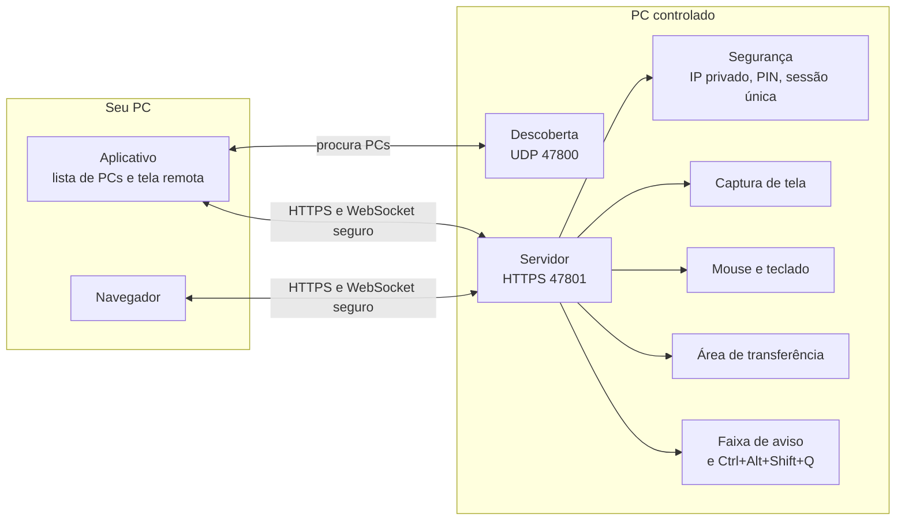

<p align="center">
  <picture>
    <source media="(prefers-color-scheme: dark)" srcset="assets/logo-dark.svg">
    <source media="(prefers-color-scheme: light)" srcset="assets/logo.svg">
    
  </picture>
</p>

<h1 align="center">Mark Mouse e Teclado Control</h1>

<p align="center">
  <a href="https://github.com/pcblindao/mark-mouse-e-teclado-control/actions/workflows/ci.yml"></a>
  <a href="LICENSE"></a>
  
  
  
</p>

<p align="center">
  <a href="https://github.com/pcblindao/mark-mouse-e-teclado-control/releases/latest">Baixar a versão mais recente</a>
  ·
  <a href="#como-usar">Como usar</a>
  ·
  <a href="#segurança">Segurança</a>
  ·
  <a href="#perguntas-frequentes">Perguntas frequentes</a>
</p>

O aplicativo encontra PCs na rede local e permite ver a tela de outro PC e usar o mouse e o teclado dele. A conexão fica na sua rede. O aplicativo dispensa conta e funciona sem servidores externos ou telemetria.

> [!IMPORTANT]
> Use apenas em PCs próprios ou com autorização do responsável, em uma rede sob seu controle. O PIN vem desligado. Enquanto o controle estiver ativado sem PIN, qualquer aparelho da rede local pode se conectar.

## Como usar

1. Abra o aplicativo nos dois PCs. A lista de PCs se atualiza a cada três segundos.
2. No PC que você quer controlar, clique em **Ativar**. Ele aparece na lista dos outros PCs com nome, IP e situação (livre ou em uso).
3. No seu PC, dê um duplo clique no nome da lista. Quando a tela remota abrir, clique nela para usar o mouse e o teclado.

Durante toda a sessão, o PC controlado mostra uma faixa com o IP de quem está conectado.

## Funcionalidades

A tabela mostra o que está disponível na versão publicada e o que está previsto.

| Área | O que faz | Estado |
| --- | --- | --- |
| Descoberta automática | Lista os PCs da rede com nome, IP e situação (livre ou em uso). Remove da lista os PCs que param de responder por dez segundos. | Disponível |
| Tela | Envia a imagem quando ela muda e, se ficar igual, a cada dois segundos. A qualidade é ajustável e a captura vai de 1 a 20 quadros por segundo. | Disponível |
| Vários monitores | Permite escolher o monitor remoto para ver e controlar. | Disponível |
| Mouse | Movimento, clique, arraste e rolagem vertical e horizontal. | Disponível |
| Teclado | Digitação direta. A caixa Digitar texto envia até 500 caracteres, incluindo acentos. | Disponível |
| Área de transferência | Colar no remoto e Copiar do remoto aceitam até 100 KiB de texto. Os atalhos são `Ctrl+Shift+V` e `Ctrl+Shift+C`. Dá para desligar o recurso. | Disponível |
| Indicadores | Mostra latência, quadros recebidos e qualidade durante a sessão. | Disponível |
| Pelo navegador | Abra `https://IP_DO_PC:47801/` para controlar o PC pelo navegador. | Disponível |
| Iniciar com o Windows | Pode abrir e ativar o controle no login do usuário. | Disponível |
| Executável único | O arquivo `Mark Mouse e Teclado Control.exe` inclui o Python. | Disponível |
| Instalador para Windows | Instalação com atalhos no menu Iniciar. | Em breve |
| Executar como administrador | Controle de janelas que pedem permissão elevada. | Em breve |
| Atualização automática | Verificação das atualizações por assinatura digital Ed25519. | Em breve |
| Transferência de arquivos | Envio e recebimento de arquivos, com autorização própria. | Em breve |
| Modo só visualizar | Visualização da tela sem controle de mouse e teclado. | Em breve |
| Teclas especiais | Botões para combinações que o sistema reserva. | Em breve |
| Chat | Mensagens entre quem controla e quem está no PC. | Em breve |
| Wake-on-LAN | Liga pela rede um PC que está desligado. | Em breve |
| Histórico de conexões | Lista das últimas conexões. | Em breve |
| Interface nova | Mudanças no visual do aplicativo. | Em breve |
| Gravação local e áudio remoto | Gravação da sessão e reprodução do som do PC remoto. | Planejado |

## Segurança

- O PC controlado aceita conexões de endereços da rede privada (como `192.168.x.x`, `10.x.x.x` e a faixa `172.16.0.0/12`) e do próprio computador. Conexões da internet são recusadas.
- O PIN é opcional e tem oito dígitos. O aplicativo guarda o resumo scrypt do PIN. Você pode lembrar um aparelho depois de ele acertar o PIN e revogar todos os aparelhos lembrados em **Esquecer aparelhos**. Cinco erros seguidos do mesmo IP em cinco minutos bloqueiam novas tentativas por dez minutos.
- Só pode haver uma sessão de controle por vez. O PC controlado toca um aviso quando a sessão começa e mostra o IP de quem está conectado.
- No PC controlado, `Ctrl+Alt+Shift+Q` encerra a sessão na hora e solta teclas e botões que ficaram pressionados. A sessão também termina após 30 minutos sem uso.
- O aplicativo mantém os dados na rede local e funciona sem baixar arquivos de terceiros. Os comandos remotos da versão atual se limitam ao mouse, ao teclado e à área de transferência.

### HTTPS

Cada PC tem seu próprio certificado. O aplicativo usa HTTPS e WebSocket seguro e guarda a impressão digital do certificado na primeira conexão. Se o certificado mudar, a conexão é interrompida. Compare o SHA-256 nos dois PCs antes de confirmar a nova identidade.

A descoberta por UDP funciona sem criptografia. Na primeira conexão, outro aparelho na mesma rede pode se passar pelo PC que você quer controlar. Se a rede não for de confiança, compare o SHA-256 nos dois PCs antes de conectar.

## Arquitetura



Veja a [arquitetura](docs/ARQUITETURA.md) e a [lista completa de funcionalidades](docs/FUNCIONALIDADES.md).

## Download e instalação

### Windows 10 e 11

1. Baixe `Mark Mouse e Teclado Control.exe` na página de [Releases](https://github.com/pcblindao/mark-mouse-e-teclado-control/releases/latest).
2. Abra o arquivo com um duplo clique. O executável já inclui o Python e roda sem instalação.
3. Faça o mesmo no outro PC.
4. Na primeira vez que clicar em **Ativar**, o Firewall do Windows pede permissão. Marque somente Redes privadas e clique em Permitir acesso.

O executável único é a opção oficial para Windows. O instalador está previsto.

### Linux (X11)

As Releases ainda não têm executável para Linux. Use o código-fonte como descrito abaixo ou compile o executável com `sh scripts/build.sh`. Você precisa estar em uma sessão X11.

### Atualizar o aplicativo

Desative a inicialização automática e feche o aplicativo nos dois PCs. Atualize os dois antes de conectar. O aplicativo usa o nome, as configurações e os aparelhos lembrados que já estiverem salvos no perfil atual.

## Instalar a partir do código-fonte

Use Python 3.10 ou superior em uma sessão gráfica no Windows 10/11 ou no Linux com X11. No Linux, instale também o Tk do Python (`python3-tk` no Debian/Ubuntu) e `xclip` ou `xsel`.

```bash
git clone https://github.com/pcblindao/mark-mouse-e-teclado-control.git
cd mark-mouse-e-teclado-control
python -m venv .venv
```

No PowerShell, ative o ambiente com `.\.venv\Scripts\Activate.ps1`. No Linux, rode `source .venv/bin/activate`.

```bash
python -m pip install .
markcontrol
```

<details>
<summary>Linha de comando, testes e executável único</summary>

| Comando | Efeito |
| --- | --- |
| `markcontrol` | Abre o aplicativo e começa a procurar PCs. |
| `markcontrol agent` | Inicia o servidor HTTPS em `0.0.0.0:47801` e a descoberta em UDP 47800. |
| `markcontrol agent --name NOME` | Muda o nome que aparece na lista. |
| `markcontrol agent --host IP --port PORTA` | Muda o endereço e a porta HTTPS. |
| `markcontrol agent --cert-ip IP` | Inclui um IP no certificado. Pode repetir a opção. |
| `markcontrol agent --no-clipboard` | Desliga a área de transferência. |
| `markcontrol scan` | Lista os PCs encontrados na rede. |
| `markcontrol scan --broadcast 192.168.1.255 --timeout 3` | Escolhe o endereço de busca e o tempo de espera. |

O pytest roda a suíte com os comandos abaixo.

```bash
python -m pip install ".[test]"
python -m pytest
```

A CI roda os testes no Windows e no Ubuntu com Python 3.10, 3.11 e 3.12.

Para fazer o executável único com PyInstaller, ative o ambiente e rode `./scripts/build.ps1` no Windows ou `sh scripts/build.sh` no Linux. A saída fica em `dist\Mark Mouse e Teclado Control.exe` no Windows e em `dist/markcontrol` no Linux.

</details>

## Perguntas frequentes

<details>
<summary>O que eu marco no Firewall do Windows?</summary>

Marque somente Redes privadas e deixe Redes públicas desmarcada. Clique em Permitir acesso. Assim o PC aceita controle apenas nas redes que você marcou como privadas.

No Linux com UFW, libere as portas apenas para a sua sub-rede. Ajuste o endereço do exemplo à sua rede.

```bash
sudo ufw allow from 192.168.1.0/24 to any port 47801 proto tcp
sudo ufw allow from 192.168.1.0/24 to any port 47800 proto udp
```
</details>

<details>
<summary>Os PCs não se encontram. Meu Wi-Fi aparece como "Rede pública".</summary>

Se o Windows classificou a rede como pública, a permissão do Firewall para redes privadas não se aplica. Abra Configurações › Rede e Internet › Wi-Fi (ou Ethernet), entre nas propriedades da rede e mude o Tipo de perfil de rede para Privada. Faça isso só em redes que você controla.

Confira também se os PCs estão na mesma rede. A rede de convidados e o isolamento de clientes no Wi-Fi podem impedir que os aparelhos se encontrem.

</details>

<details>
<summary>Funciona no Linux com Wayland?</summary>

Ainda não. O Wayland limita a captura da tela inteira e a simulação de mouse e teclado. O aplicativo avisa e mantém o controle desativado. Na tela de login, escolha uma sessão X11, que pode aparecer como "Xorg".

</details>

<details>
<summary>Dá para controlar um PC pela internet?</summary>

O controle foi feito para a rede local e só aceita conexões de endereços privados e do próprio PC.

</details>

<details>
<summary>Por que algumas telas ou atalhos não respondem?</summary>

Telas protegidas, como a confirmação do UAC no Windows, e atalhos que o sistema ou o navegador reservam podem ficar fora de alcance. O modo administrador e os botões de teclas especiais estão previstos.

</details>

<details>
<summary>O aplicativo coleta algum dado?</summary>

O aplicativo não tem telemetria, conta ou serviços na nuvem. O registro local da área de transferência guarda o tipo e o tamanho da operação. O conteúdo fica fora do registro.

</details>

## Licença

Distribuído sob a [licença MIT](LICENSE).
