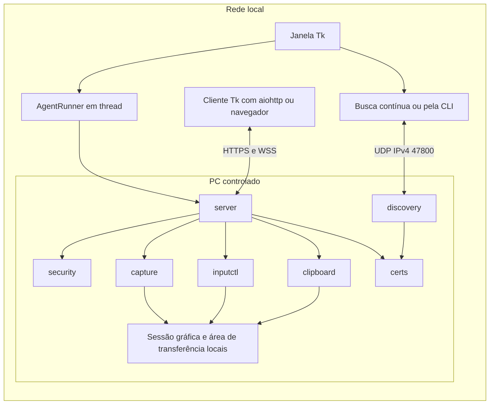
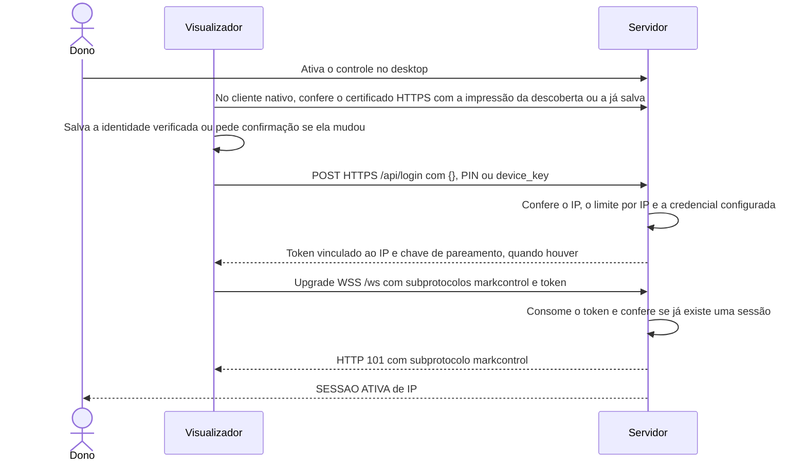
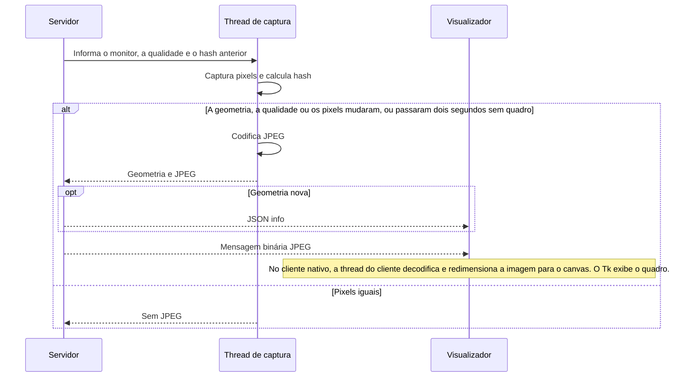
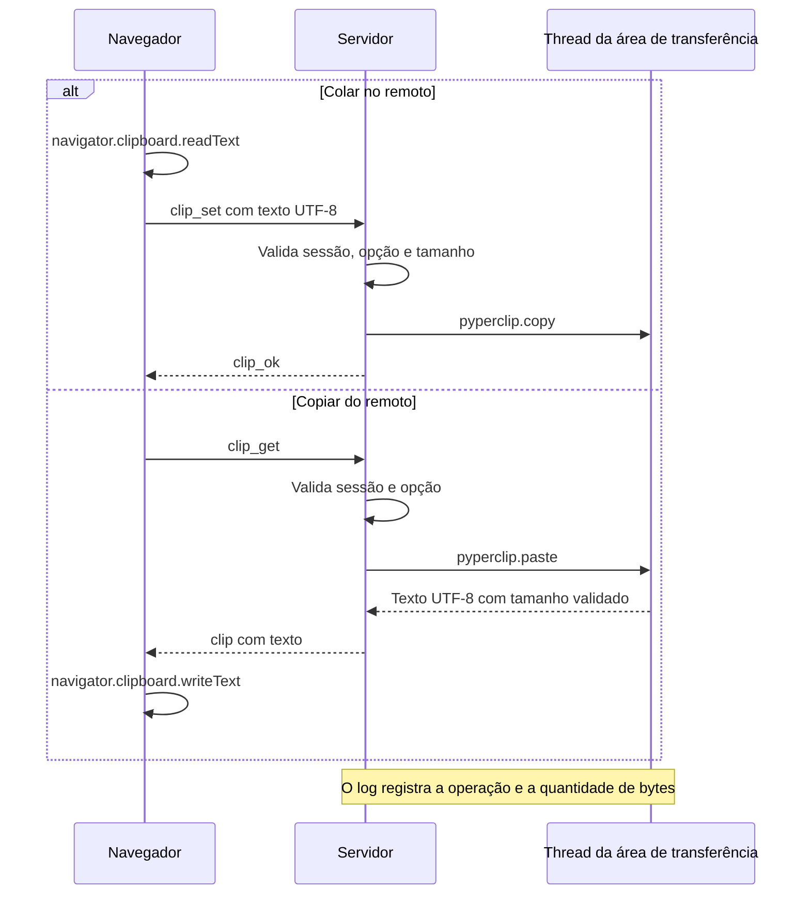
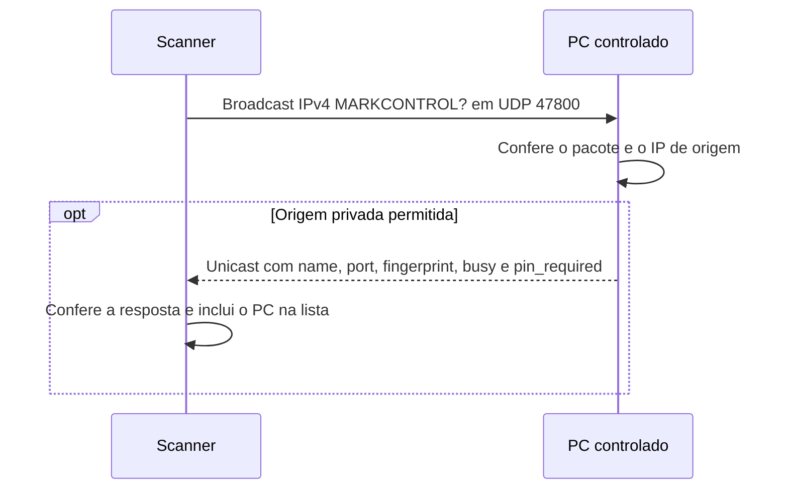
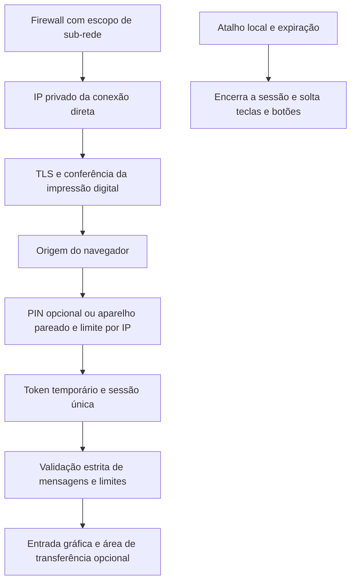

# Arquitetura

## Componentes

## Login e WebSocket

## Captura da tela

## Área de transferência

## Descoberta

## Camadas de segurança

| Módulo | Responsabilidade | Arquivo |
| --- | --- | --- |
| CLI | Lê as opções e os comandos e confere a sessão gráfica. | `markcontrol/cli.py` |
| Servidor | Gerencia o ciclo de vida das conexões HTTPS e WSS e envia os quadros. | `markcontrol/server.py` |
| Segurança | Confere IP, PIN e token, aplica o limite de tentativas e valida as mensagens. | `markcontrol/security.py` |
| Certificados | Criação e carregamento de identidade TLS e impressão digital | `markcontrol/certs.py` |
| Descoberta | Envia consultas e responde por UDP IPv4. | `markcontrol/discovery.py` |
| Captura | Monitor, hash dos pixels e codificação JPEG | `markcontrol/capture.py` |
| Entrada | Controla mouse e teclado e registra o atalho global. | `markcontrol/inputctl.py` |
| Área de transferência | Lê e escreve em uma thread e aplica o limite de bytes UTF-8. | `markcontrol/clipboard.py` |
| Visualizador | PIN, canvas, comandos e estatísticas no navegador | `markcontrol/static/index.html`, `markcontrol/static/viewer.js` e `markcontrol/static/style.css` |
| Janela e controle local | Atualiza a descoberta de PCs, ativa o controle local e cuida da inicialização no login e da faixa obrigatória. | `gui/app.py`, `gui/autostart.py`, `agent_runner.py` |
| Cliente nativo | HTTPS/WSS com SHA-256 fixado, fila de eventos, quadros e entrada Tk | `client.py`, `gui/viewer.py` |
| Persistência | Guarda a configuração, o resumo scrypt do PIN e os resumos das chaves no PC controlado. O visualizador mantém `known_hosts`. | `config.py`, `trust.py` |

Por padrão, o scanner consulta o broadcast global e os endereços de broadcast das interfaces IPv4 privadas. Se só tiver o IP local, assume máscara `/24`. Para escolher o destino, use `scan --broadcast`. O scanner lista uma única resposta por IP.

O scanner completa a consulta `MARKCONTROL?` até 1280 bytes. Se a consulta for curta, o PC responde com `PAD 1280`. Cada consulta válida recebe no máximo um datagrama de resposta, com tamanho igual ou menor que o da solicitação. O scanner lê o IP de origem no socket UDP.

O cliente só salva a confiança depois de validar o certificado HTTPS. Ele recusa redirecionamentos e só envia a chave de pareamento ao servidor com a identidade salva.

## Extensões do protocolo

A mensagem `info` traz `features`, um objeto com valores booleanos para `files`, `view_only`,
`combo`, `chat`, `clipboard`, `wol` e `history`. Uma chave ausente indica recurso
indisponível. O sistema escolhe o MAC, que é opcional. Em PCs com mais de uma
interface, esse endereço pode ser de outra placa. O cliente pode guardar esse valor
junto à identidade verificada na integração com a interface.

* `Client.send_file(path, progress_cb)` inicia um envio após o primeiro `info`.
  O cabeçalho JSON `file_begin` contém `name` e `size` em bytes. O servidor responde
  `file_ready` ao cabeçalho e a cada mensagem binária de 256 KiB (a última pode ser
  menor). Arquivos vazios passam direto ao `file_end` com `sha256` hexadecimal.
  O servidor confere o tamanho e o hash antes de salvar o arquivo. Nomes repetidos recebem
  sufixos como ` (1)`. Em Linux, o volume de destino precisa aceitar hard links.
  O callback recebe `(bytes_confirmados, total)` na thread do cliente.
  `cancel_file()` solicita `file_cancel` antes de concluir o envio. A fila de
  eventos entrega `(file_ok|file_cancelled|file_error, None)`. Se a conexão cair,
  a sessão termina e o servidor descarta o arquivo parcial. A opção booleana `files`
  começa ligada e pode ser salva com `Config.save(..., files=False)`.
* `set_view_only(bool)` envia `view_only` com `enabled`. Ao ativar o modo, o servidor solta
  as teclas e os botões pressionados e confirma o estado por eco. A leitura da
  área de transferência segue a própria permissão. `send_combo(lista)` envia `combo` com `keys`.
  Cada elemento usa a grafia da tabela de funcionalidades (por exemplo,
  `["Ctrl", "Shift", "Esc"]`). Os efeitos dependem do desktop e do SO.
* `send_chat(texto)` envia `chat` com `s`. O servidor aceita uma mensagem por segundo
  e chama `notify("chat", {"text": texto, "reply": callback})`. A interface pode
  chamar `callback(resposta)` uma vez nessa sessão. O cliente recebe o evento
  `("chat", resposta)`. O histórico e o console omitem nomes de arquivo, conteúdo,
  teclas e credenciais.
* `wol.broadcasts()` mapeia broadcasts privados a IPs de interfaces locais.
  `wol.wake(mac, broadcast)` envia um datagrama UDP à porta 9 pela interface
  correspondente. O PC que controla faz o envio, inclusive com seu servidor local desligado.
* `history.json` fica ao lado de `config.json`. A gravação usa lock, troca atômica
  e arquivo temporário privado (0600 em POSIX, ACL herdada do perfil em Windows).
  `started` é UTC em ISO 8601 e `duration_s` usa o relógio monotônico.
